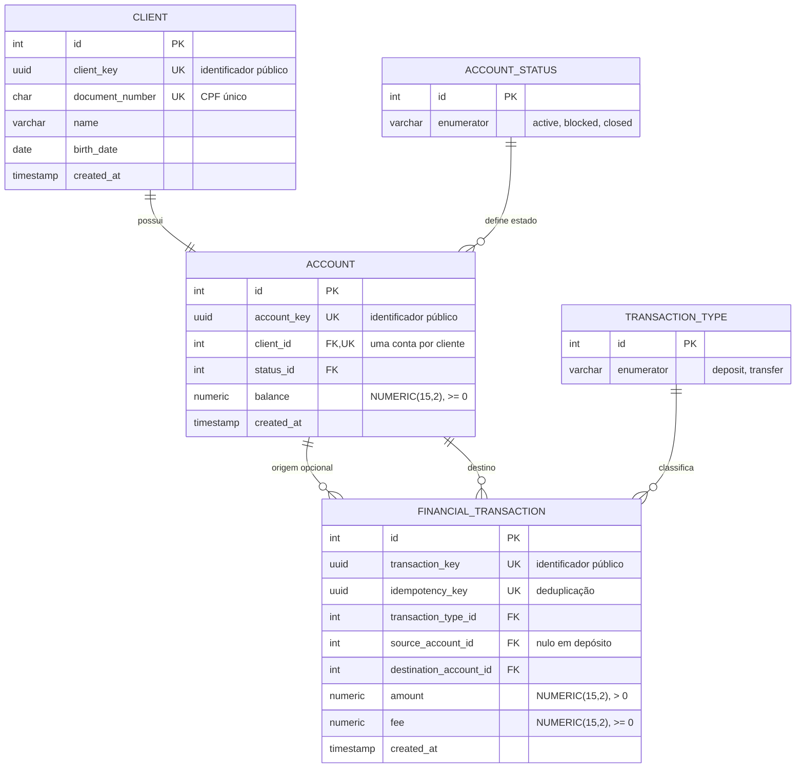

# RFC — API bancária consistente sob concorrência e retentativas

|  |  |
| :---- | :---- |
| **Time** | Helamã Oliveira Lopes · Caio Tatsuo Miyamura · Bernardo Camargo Zampieri |
| **Data** | 11/10/2026 |
| **Versão** | 7 |

## Contextualização

### Entendendo o problema

A API deve oferecer cadastro de clientes, criação e gerenciamento de contas, depósitos, transferências com tarifa, consulta de saldo e extrato paginado. O ponto crítico é que essas operações alteram dinheiro e podem chegar simultaneamente ou ser reenviadas após timeout ou falha de comunicação. O sistema precisa impedir saldo negativo, saldo divergente, movimentação duplicada, perda de atualização e estado parcial quando uma operação falha no meio. O histórico também precisa permanecer coerente com as movimentações efetivamente realizadas, inclusive quando a mesma requisição é repetida. Cada cliente pode ter somente uma conta, e estados da conta devem limitar corretamente o que ela pode receber ou enviar. Ficam fora do escopo autenticação de usuário final, PIX, cartões, juros, estornos, múltiplas moedas, conciliação externa e um ledger contábil completo de partidas dobradas.

### Explicando a solução de forma macro

A solução mantém o saldo corrente diretamente em `account` e registra cada depósito ou transferência em `financial_transaction`. A requisição passa por Resource, Controller e Repository: a interface HTTP e o contrato ficam separados das regras de negócio e do acesso ao PostgreSQL. Alterações financeiras são atômicas: saldo e histórico são confirmados juntos ou desfeitos juntos. Depósitos bloqueiam a conta antes de alterar o saldo; transferências bloqueiam origem e destino em ordem determinística. Restrições `UNIQUE` no banco complementam as validações da aplicação para CPF, relação cliente-conta e `idempotency_key`. Valores monetários usam `Decimal` e `NUMERIC(15,2)`, e a tarifa de transferência é calculada em 1% com arredondamento `ROUND_HALF_UP`.

- **Calcular o saldo somente a partir do extrato** — descartado porque toda consulta exigiria agregar o histórico e aumentaria custo e complexidade. Ganharia se o objetivo fosse um ledger imutável completo em que o saldo fosse sempre derivado dos lançamentos.
- **Usar lock otimista com coluna de versão** — descartado porque conflitos exigiriam retries explícitos e adicionariam complexidade ao fluxo financeiro. Ganharia em um cenário de baixa contenção e grande necessidade de paralelismo.
- **Representar uma transferência como duas linhas, débito e crédito** — descartado porque o escopo permite uma única transação contendo origem, destino, valor e tarifa. Ganharia em um sistema contábil de partidas dobradas ou com reconciliação financeira mais sofisticada.
- **Guardar snapshots de saldo em cada transação para reproduzir exatamente a resposta de um retry** — descartado porque exigiria campos adicionais e maior acoplamento entre histórico e resposta. Ganharia se a API precisasse garantir resposta byte a byte idêntica em toda retentativa.

## Implementação

### Rotas

| Método | Caminho | O que faz | Entrada (campos que importam) | Saídas (status e quando) |
| :---- | :---- | :---- | :---- | :---- |
| `POST` | `/clients` | Cadastra cliente | `name`, `document_number`, `birth_date` | `201` criado; `400` contrato, CPF ou data inválida; `409` CPF já cadastrado; `422` cliente menor de 18 anos. Não é idempotente por chave, mas `UNIQUE(document_number)` impede duplicidade inclusive sob concorrência. |
| `POST` | `/accounts` | Cria a única conta do cliente, iniciando em `active` e `0.00` | `client_key` | `201` criada; `400` contrato inválido; `404` cliente inexistente; `409` cliente já possui conta. `UNIQUE(client_id)` garante a regra em corrida. |
| `GET` | `/accounts/{account_key}/balance` | Consulta o saldo corrente | `account_key` | `200` saldo; `400` identificador inválido; `404` conta inexistente. Leitura naturalmente idempotente. |
| `GET` | `/accounts/{account_key}/statement` | Retorna extrato paginado, mais recente primeiro, indicando `IN`/`OUT` | `account_key`, `page`, `page_size` | `200` extrato; `400` identificador ou paginação inválida; `404` conta inexistente. Leitura naturalmente idempotente. |
| `PATCH` | `/accounts/{account_key}/status` | Bloqueia, desbloqueia ou encerra conta | `account_key`, `status` | `200` status alterado; `400` contrato inválido; `404` conta inexistente; `422` transição proibida ou tentativa de fechar conta com saldo. `closed` é definitivo. |
| `POST` | `/deposits` | Credita valor e registra depósito | `account_key`, `amount`, `idempotency_key` | `201` realizado ou retry válido; `400` contrato/formato/limite de entrada inválido; `404` conta inexistente; `409` mesma chave com operação diferente; `422` conta não pode receber ou saldo resultante excede o limite. Idempotente por `idempotency_key` + `UNIQUE`. |
| `POST` | `/transfers` | Transfere valor, cobra 1% de tarifa e registra uma transação | `source_account_key`, `destination_account_key`, `amount`, `idempotency_key` | `201` realizada ou retry válido; `400` contrato/formato/limite de entrada inválido; `404` uma das contas não existe; `409` chave reutilizada com dados diferentes; `422` mesma conta, status incompatível, saldo insuficiente ou overflow. Idempotente por `idempotency_key` + `UNIQUE`. |

### Banco de Dados (Somente diagrama)

### Fluxos

**Cadastro de cliente — caminho feliz**

1. O contrato é validado e o CPF é normalizado/validado; a data de nascimento precisa existir, não pode estar no futuro e a idade precisa ficar entre 18 e 120 anos.
2. A aplicação verifica se o CPF já existe e cria o cliente quando a regra é satisfeita.
3. O `commit` confirma o registro e a resposta retorna `client_key`.
4. A restrição `UNIQUE(document_number)` permanece como garantia final caso duas requisições com o mesmo CPF passem pela verificação inicial ao mesmo tempo.

**Cadastro de cliente — falha: duas requisições concorrentes com o mesmo CPF**

1. As duas requisições podem observar inicialmente que o CPF ainda não existe.
2. Uma delas confirma primeiro; a segunda encontra `IntegrityError` na constraint `UNIQUE`.
3. A sessão da segunda operação executa `rollback`, a aplicação confirma que o CPF passou a existir e converte o caso esperado em `409`, em vez de transformar qualquer erro de banco em conflito.
4. O resultado persistido é exatamente um cliente.

**Criação de conta — caminho feliz**

1. A aplicação localiza o cliente por `client_key` e verifica se ele ainda não possui conta.
2. A conta é criada com saldo `0.00` e status `active`.
3. O `commit` confirma a operação e retorna `account_key`, saldo e status.
4. `UNIQUE(client_id)` garante no PostgreSQL que um cliente nunca terá duas contas, mesmo com chamadas simultâneas.

**Depósito — caminho feliz**

1. O `amount` precisa ser positivo, possuir duas casas decimais e caber em `NUMERIC(15,2)`, cujo maior valor aceito é `9999999999999.99`.
2. A aplicação procura uma transação existente pela `idempotency_key`. Se a mesma operação já existir, não movimenta dinheiro novamente e devolve a transação original com o saldo corrente.
3. Sem retry existente, a conta é carregada com `SELECT FOR UPDATE`, serializando depósitos e outras alterações que disputem aquele saldo.
4. A idempotência é verificada novamente depois do lock. A conta precisa estar `active` ou `blocked`, e `saldo + amount` não pode exceder o limite monetário.
5. O saldo é atualizado e o depósito é inserido em `financial_transaction` com `fee = 0.00` dentro da mesma transação de banco.
6. O `commit` confirma saldo e histórico juntos. A resposta retorna `transaction_key`, valor e saldo.

**Depósito — falha: concorrência, overflow ou retry conflitante**

1. Dois depósitos legítimos na mesma conta não podem sobrescrever o saldo um do outro: o `FOR UPDATE` faz uma operação aguardar a outra, evitando `lost update`.
2. Se o saldo resultante ultrapassar `9999999999999.99`, a operação retorna `422` e nenhum lançamento é persistido.
3. Se a `idempotency_key` já pertencer a outro valor, conta ou tipo de operação, retorna `409`.
4. Se duas requisições iguais com a mesma chave chegarem simultaneamente, a constraint `UNIQUE(idempotency_key)` resolve a corrida final; após `rollback`, a aplicação recupera a transação já criada e retorna o mesmo `transaction_key`, sem duplicar o crédito.

**Transferência — caminho feliz**

1. O valor é validado e origem e destino precisam ser diferentes.
2. A tarifa é calculada como `amount × 0.01` usando `Decimal` e `ROUND_HALF_UP`; o débito total é `amount + fee`.
3. Antes de movimentar dinheiro, a aplicação verifica a `idempotency_key`. Um retry válido não repete a transferência.
4. Origem e destino são carregados com `SELECT FOR UPDATE` sempre em ordem crescente do `Account.id`, independentemente do sentido A→B ou B→A.
5. A origem precisa estar `active`; o destino pode estar `active` ou `blocked`; a origem precisa ter saldo para `amount + fee`.
6. O total debitado precisa caber no limite monetário e o saldo do destino após receber `amount` não pode ultrapassar `9999999999999.99`.
7. A origem é debitada em `amount + fee`, o destino recebe somente `amount`, e uma única `financial_transaction` registra origem, destino, valor e tarifa.
8. O `commit` confirma os dois saldos e o histórico de forma atômica. Para o extrato, a origem vê `OUT` com a tarifa e o destino vê `IN` com tarifa `0.00`.

**Transferência — falha: duas operações disputam o mesmo saldo**

1. Duas transferências podem chegar ao mesmo tempo tentando gastar o mesmo saldo da origem.
2. O lock da conta faz uma delas executar primeiro. Depois do primeiro `commit`, a segunda lê o saldo já atualizado.
3. Se o saldo restante não cobrir `amount + fee`, a segunda retorna `422`; não existe double-spend e nenhum estado parcial é gravado.
4. Em transferências simultâneas A→B e B→A, ambas tentam adquirir os locks na mesma ordem de `Account.id`, reduzindo o risco de deadlock causado por ordem inversa de aquisição.

**Alteração de status — caminho feliz e falhas relevantes**

1. Uma conta `active` pode ser bloqueada; uma conta `blocked` pode voltar a `active`.
2. Uma conta só pode ir para `closed` quando o saldo é exatamente zero.
3. `closed` é estado final: depois do encerramento não há desbloqueio nem reativação.
4. `blocked` continua podendo receber e ser consultada, mas não pode enviar transferências; `closed` não pode receber nem enviar, mas saldo e histórico continuam consultáveis.

**Extrato — caminho feliz**

1. A conta é localizada e as transações relacionadas a ela são consultadas com paginação.
2. O resultado é ordenado das movimentações mais recentes para as mais antigas.
3. Cada item é contextualizado para a conta consultada: depósito e transferência recebida aparecem como `IN`; transferência enviada aparece como `OUT`.
4. A tarifa real aparece na saída da origem; para a conta que recebeu a transferência, a tarifa exibida é `0.00`.

> ## Principal desafio
>
> - **Qual é:** preservar a consistência financeira quando operações sobre as mesmas contas acontecem concorrentemente e quando clientes repetem requisições após timeout ou falha de comunicação.
> - **Por que é difícil:** uma validação feita antes da escrita não é suficiente. Duas threads podem ler o mesmo saldo e ambas acreditar que podem gastá-lo; dois depósitos podem sobrescrever atualizações; duas requisições com a mesma chave podem passar simultaneamente pela primeira consulta de idempotência; transferências opostas podem adquirir locks em ordem diferente e gerar deadlock. Além disso, uma falha entre atualizar o saldo e registrar o histórico deixaria o sistema incoerente se as duas mudanças não fossem atômicas.
> - **Como o desenho resolve:** cada movimentação financeira executa saldo e histórico na mesma transação de PostgreSQL; `SELECT FOR UPDATE` serializa alterações das contas; transferências bloqueiam as duas contas em ordem determinística de `Account.id`; `UNIQUE` reforça CPF, uma conta por cliente e `idempotency_key`; `IntegrityError` esperado provoca `rollback` e é traduzido para o comportamento de negócio; retries válidos recuperam a transação existente e não movimentam dinheiro novamente. A suíte de integração valida esses mecanismos, incluindo depósitos simultâneos sem `lost update`, transferências concorrentes sem double-spend, mesma chave concorrente sem duplicidade, transferências opostas sem deadlock e cadastros concorrentes respeitando unicidade.

&nbsp;
